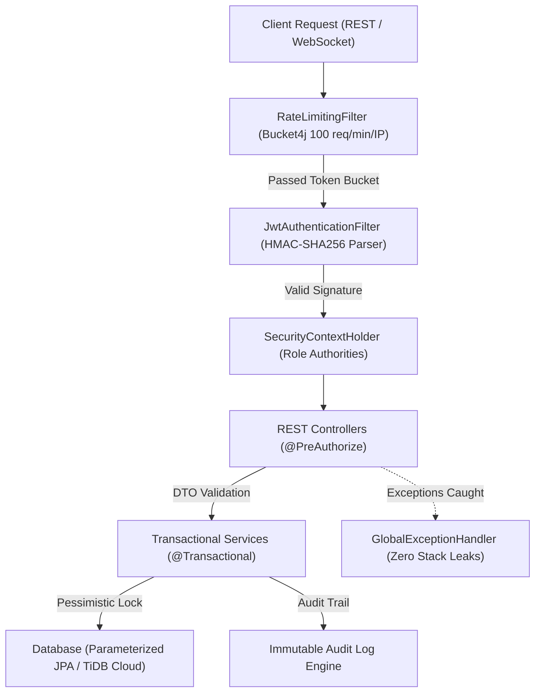

# Nexora Backend: Security Architecture & Cryptographic Governance

## 1. Zero-Trust Backend Security Philosophy
The **Nexora Spring Boot Core** operates under an uncompromising **Zero-Trust Architecture**. No client request is inherently trusted; every inbound REST and WebSocket frame must satisfy cryptographic verification, IP rate-limiting, method-level authorization, and parameterized database boundaries.



---

## 2. Threat Vector Defense Matrix

| Attack Vector | Vulnerability Category | Nexora Defense Mechanism | Implementation Details |
|---|---|---|---|
| **Brute-Force & Credential Stuffing** | OWASP A07: Auth Failures | Bucket4j Token Bucket Algorithm | [`RateLimitingFilter.java`](file:///d:/Project/new%20site/markettrust/backend/src/main/java/com/markettrust/security/RateLimitingFilter.java) enforces a strict 100 requests/minute ceiling per IP. Rejects flood attacks with HTTP 429 Too Many Requests. |
| **Privilege Escalation** | OWASP A01: Broken Access Control | Spring Method Security (`@EnableMethodSecurity`) | Every sensitive controller method enforces `@PreAuthorize("hasAnyAuthority(...)")`. User IDs are extracted server-side from `SecurityUtils.getCurrentUserId()`, never trusted from query parameters. |
| **Token Forgery & Replay** | OWASP A02: Cryptographic Failures | JJWT with 256-bit HMAC Key | [`JwtTokenProviderImpl.java`](file:///d:/Project/new%20site/markettrust/backend/src/main/java/com/markettrust/security/JwtTokenProviderImpl.java) signs tokens using strong secret keys. Tokens expire in 15 minutes; refresh tokens are stored in the database and can be revoked instantly. |
| **SQL Injection** | OWASP A03: Injection | Parameterized Hibernate / JPA Queries | All Spring Data JPA repositories bind arguments through named parameters (`:param`). Native SQL queries use strictly parameterized binds, eliminating SQL string concatenation exploits. |
| **Escrow Double-Spending & Race Conditions** | OWASP A04: Insecure Design | Pessimistic Locking & Idempotency Keys | Wallet credit operations use database row locking (`@Lock(LockModeType.PESSIMISTIC_WRITE)`) and check unique `idempotencyKey` strings before state transitions. |
| **Information Disclosure & Stack Leaks** | OWASP A05: Security Misconfiguration | Sanitized `@RestControllerAdvice` | [`GlobalExceptionHandler.java`](file:///d:/Project/new%20site/markettrust/backend/src/main/java/com/markettrust/exception/GlobalExceptionHandler.java) intercepts all uncaught exceptions and returns standard JSON envelopes. Zero internal Java stack traces are ever exposed to callers. |
| **Container Breakout & Host Escape** | OWASP A06: Vulnerable Components | Hardened Non-Root Container Execution | Docker container drops all root privileges on boot, executing exclusively under the unprivileged `appuser:appgroup` service account. |

---

## 3. Escrow Concurrency & Financial Transaction Safety

To ensure escrow credits cannot be duplicated, drained, or manipulated during simultaneous requests:
1. **Pessimistic Row Lock**:
   ```java
   @Lock(LockModeType.PESSIMISTIC_WRITE)
   Optional<Wallet> findByUserId(Long userId);
   ```
2. **Idempotency Guarantee**:
   All purchase hold dispatches (`/api/orders`) and administrative adjustments require a client-generated UUID `idempotencyKey`. If a duplicate request arrives, the existing confirmed transaction is returned without secondary execution.
3. **Escrow State Integrity**:
   Funds move strictly between `availableCredits` and `heldCredits` within atomic `@Transactional` isolation boundaries.

---

## 4. Automated CI/CD Pipeline Workflow

The backend CI/CD pipeline is codified in [`.github/workflows/backend-ci-cd.yml`](file:///d:/Project/new%20site/markettrust/backend/.github/workflows/backend-ci-cd.yml):

```
.github/workflows/backend-ci-cd.yml
├── ☕ Stage 1: Java 21 Toolchain & Maven Compilation
├── 🛡️ Stage 2: Static Security SAST & Trufflehog Secret Scan
├── 📦 Stage 3: Executable JAR Package & SHA256 Checksumming
├── 🐳 Stage 4: Docker Container Build & Trivy CVE Security Scan
└── 🚀 Stage 5: Gated Production Zero-Downtime Deployment
```

---

## 5. Security Incident Response & Reporting

For responsible vulnerability reporting:
- **Security Contact**: `security@nexora.marketplace`
- **Initial Triage SLA**: Within 24 hours
- **Remediation SLA**: Within 48 hours for critical/high vulnerabilities
